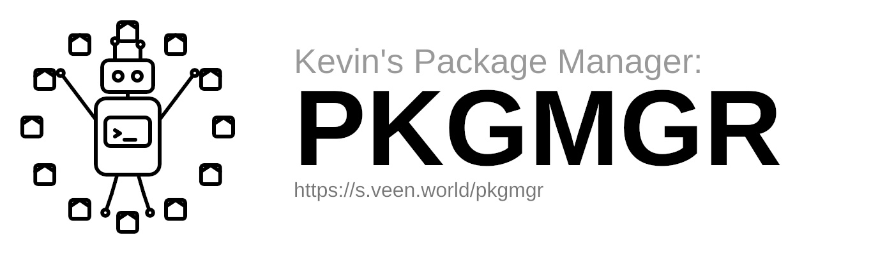
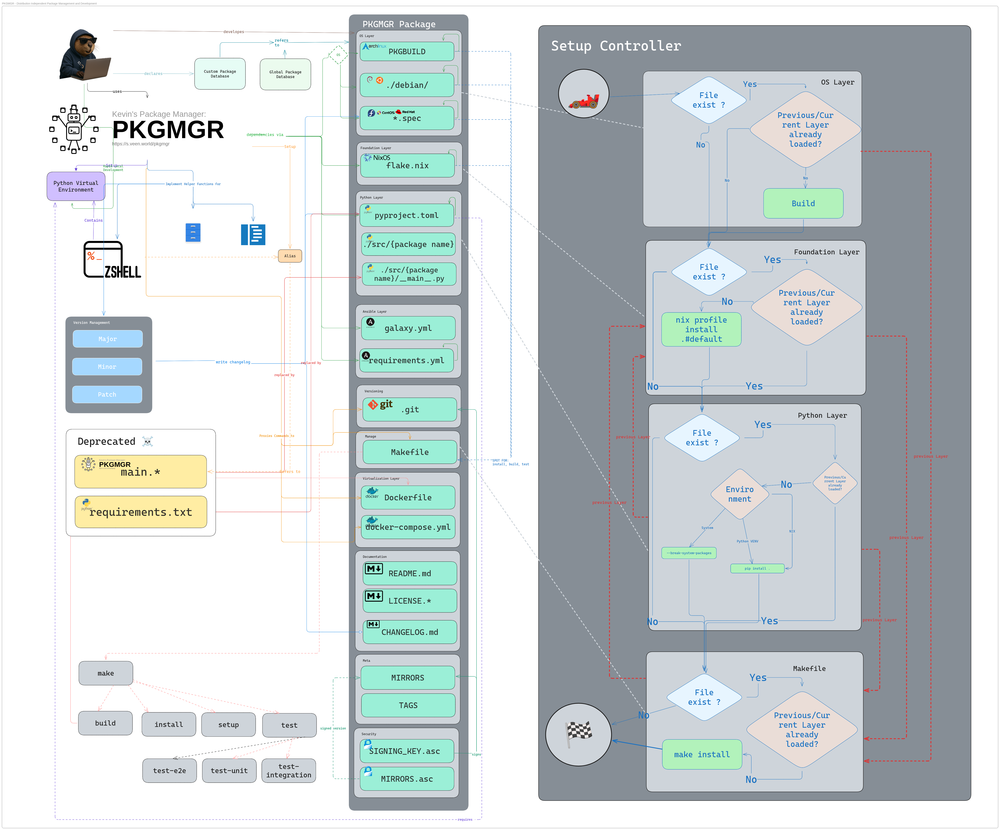

# Package Manager 🤖📦



[](https://github.com/sponsors/kevinveenbirkenbach)
[](https://www.patreon.com/c/kevinveenbirkenbach)
[](https://buymeacoffee.com/kevinveenbirkenbach)
[](https://s.veen.world/paypaldonate)
[](LICENSE)
[](https://github.com/kevinveenbirkenbach/package-manager)
[](https://github.com/kevinveenbirkenbach/package-manager/actions/workflows/mark-stable.yml)

[**Kevin's Package Manager (PKGMGR)**](https://s.veen.world/pkgmgr) is a *multi-distro* package manager and workflow orchestrator.
It helps you **develop, package, release and manage projects across multiple Linux-based
operating systems** (Arch, Debian, Ubuntu, Fedora, CentOS, …).

PKGMGR is implemented in **Python** and uses **Nix (flakes)** as a foundation for
distribution-independent builds and tooling. On top of that it provides a rich
CLI that proxies common developer tools (Git, Docker, Make, …) and glues them
together into repeatable development workflows.

---

## Why PKGMGR? 🧠

Traditional distro package managers like `apt`, `pacman` or `dnf` focus on a
single operating system. PKGMGR instead focuses on **your repositories and
development lifecycle**. It provides one configuration for all repositories,
one unified CLI to interact with them, and a Nix-based foundation that keeps
tooling reproducible across distributions.

Native package managers are still used where they make sense. PKGMGR coordinates
the surrounding development, build and release workflows in a consistent way.

In addition, PKGMGR provides Docker images that can serve as a **reproducible
system baseline**. These images bundle the complete PKGMGR toolchain and are
designed to be reused as a stable execution environment across machines,
pipelines and teams. This approach is specifically used within
[**Infinito.Nexus**](https://s.infinito.nexus/code) to make complex systems
distribution-independent while remaining fully reproducible.

---

## Features 🚀

PKGMGR enables multi-distro development and packaging by managing multiple
repositories from a single configuration file. It drives complete release
pipelines across Linux distributions using Nix flakes, Python build metadata,
native OS packages such as Arch, Debian and RPM formats, and additional ecosystem
integrations like Ansible.

All functionality is exposed through a unified `pkgmgr` command-line interface
that works identically on every supported distribution. It combines repository
management, Git operations, Docker and Compose orchestration, as well as
versioning, release and changelog workflows. Many commands support a preview
mode, allowing you to inspect the underlying actions before they are executed.

---

### Full development workflows

PKGMGR is not just a helper around Git commands. Combined with its release and
versioning features it can drive **end-to-end workflows**:

1. Clone and mirror repositories.
2. Run tests and builds through `make` or Nix.
3. Bump versions, update changelogs and tags.
4. Build distro-specific packages.
5. Keep all mirrors and working copies in sync.

---

### Worktrees and garbage collection

| Command | Does |
| --- | --- |
| `pkgmgr worktree up <branch> [--base REF] [--path DIR]` | Checks the branch out under `<directories.worktrees>/<host>/<owner>/<repo>/<branch>` or at `--path`, assigns a free slot and runs the pinned `worktree-init` hook |
| `pkgmgr worktree cleanup [--apply]` | Removes clean worktrees whose commits are merged or pushed: pinned `worktree-fini` hook, compose stack, checkout; the branch stays |
| `pkgmgr branch cleanup [--apply]` | Removes merged branches that no worktree holds, locally and on the remotes |
| `pkgmgr branch tree [--format json\|yaml] [--output FILE]` | Writes every managed repository's branches and worktrees with their cleanup state, without fetching |
| `pkgmgr gc [--all] [--apply]` | Both cleanups in one pass, for the current repository or every managed one |
| `pkgmgr worktree orphans --stale-days N --top N` | Lists merged and abandoned branches and worktrees with a proposal each |

A hook runs only when the `worktree_hooks` config pins its command under the
`<provider>/<account>/<repository>` of a repository managed in the pkgmgr
config, and only for that repository's directory; origin's URL, which the
repository's own config sets, never selects a pin. `{path}` and `{slot}` are
replaced; a
`worktree-init` or `worktree-fini` target in the repository's Makefile is
reported, never run, because an agent may have written it. The pinned program
must be an absolute path or a root-owned command on a `PATH` entry that root
owns and no group or other user can write, up to `/`, so a binary planted in a
user-writable directory such as a virtualenv never runs. The Nix store never
counts: it is group-writable, and any user can have the daemon build
root-owned content there, so pin an absolute path on Nix. A bare name runs as
the resolved file that was checked. Inside a user namespace other than the
initial one, root means the overflow uid, under which the real root's files
show there, as do those of every other unmapped owner. Outside such a
namespace a directory on a nosuid mount, where udisks2 and FUSE put user
mounts, never counts as root's. The hook runs with
stdin closed, only those `PATH` entries and a 30 minute timeout. Removal walks to
the worktree without following a symbolic link and skips a worktree path that
is not its own realpath. A pinned command that reads repository files, such as `make` or a
script in the repository, trusts the worktree's content, tracked or ignored.

Every cleanup is a dry run until `--apply`, and `--json` prints the plan for
other tools. The [agent skills](https://github.com/kevinveenbirkenbach/skills)
wrap these commands; see [AGENTS.md](AGENTS.md) for the split.

---

## Architecture & Setup Map 🗺️

The following diagram gives a full overview of:

* PKGMGR’s package structure,
* the layered installers (OS, foundation, Python, Makefile),
* and the setup controller that decides which layer to use on a given system.




**Diagram status:** 12 December 2025

**Always-up-to-date version:** [https://s.veen.world/pkgmgrmp](https://s.veen.world/pkgmgrmp)

---

## Installation ⚙️

PKGMGR can be installed using `make`.
The setup mode defines **which runtime layers are prepared**.
---

### Download

```bash
git clone https://github.com/kevinveenbirkenbach/package-manager.git
cd package-manager
```

### Dependency installation (optional)

System dependencies required **before running any *make* commands** are installed via:

```
scripts/installation/dependencies.sh
```

The script detects and normalizes the OS and installs the required **system-level dependencies** accordingly.

### Install

```bash
git clone https://github.com/kevinveenbirkenbach/package-manager.git
cd package-manager
make install
```

### Setup modes

| Command             | Prepares                | Use case              |
| ------------------- | ----------------------- | --------------------- |
| **make setup**      | Python venv **and** Nix | Full development & CI |
| **make setup-venv** | Python venv only        | Local user setup      |


##### Full setup (venv + Nix)

```bash
make setup
```

Use this for CI, servers, containers and full development workflows.

##### Venv-only setup

```bash
make setup-venv
source ~/.venvs/pkgmgr/bin/activate
```

Use this if you want PKGMGR isolated without Nix integration.

---

Alles klar 🙂
Hier ist der **RUN-Abschnitt ohne Gedankenstriche**, klar nach **Nix, Docker und venv** getrennt:

---

## Run PKGMGR 🧰

PKGMGR can be executed in different environments.
All modes expose the same CLI and commands.

---

### Run via Nix (no installation)

```bash
nix run github:kevinveenbirkenbach/package-manager#pkgmgr -- --help
```

---

### Run via Docker 🐳

PKGMGR can be executed **inside Docker containers** for CI, testing and isolated
workflows.

---

#### Container images

One image per distribution, each installing PKGMGR as a distro-native package
on top of the matching base image from
[base-images](https://github.com/kevinveenbirkenbach/base-images). Every image
is a manifest list covering `linux/amd64` and `linux/arm64`.

All images live under `ghcr.io/kevinveenbirkenbach/`:

| Tag                                   | Contains                                                  |
| ------------------------------------- | --------------------------------------------------------- |
| `pkgmgr-<distro>:latest`              | newest build of the newest release on `main`              |
| `pkgmgr-<distro>:stable`              | newest build of the release the git tag `stable` marks    |
| `pkgmgr-<distro>:<major>`             | newest build of the newest release of that major          |
| `pkgmgr-<distro>:<major>.<minor>`     | newest build of the newest release of that minor          |
| `pkgmgr-<distro>:<version>`           | newest build of that release                              |
| `pkgmgr-<distro>:<version>.<unix-ts>` | one build, never moves                                    |

`<distro>` is one of `arch`, `debian`, `ubuntu`, `fedora`, `centos`. The Arch
image is published without the suffix as well, so `pkgmgr:stable` and
`pkgmgr-arch:stable` are the same image.

`<version>` is the PKGMGR release and `<unix-ts>` the build time, so
`2.3.0.1767225600` is a full version an updater can order and pin. Every tag of
one build points at the same image.

`stable` moves only once "Mark stable commit" has moved the git tag `stable`,
which it does after every test of that release passed. Every day at 03:00 UTC,
after the daily 00:00 UTC build of base-images, and on demand through the
workflow's manual trigger, two releases are rebuilt on the newest base image:

- the newest `vX.Y.Z` release on `main`, moving `latest`, its prefixes and
  `<version>`, and adding `<version>.<unix-ts>`;
- the release the git tag `stable` marks, when that is an older one, moving
  `stable` and `<version>`, adding its own `<version>.<unix-ts>`, and moving a
  prefix only while it is still the newest release of that prefix.

With newest `2.4.0` and stable `2.3.0`, `2.4.0` takes `latest`, `2` and `2.4`,
and `2.3.0` takes `stable` and `2.3`. A security update in base-images thereby
reaches whoever pinned a major, a minor, a release or follows `stable`.

Each release is compared with its own published `<version>`. A rebuild whose
installed packages equal it pushes nothing, since a new timestamp tag would make
every pin bump for no change; a tag of that release that does not show the
published build yet, such as `stable` right after "Mark stable commit", is moved
without a new timestamp.

A rebuild runs the build scripts of the release it rebuilds, not those of
`main`, so the skip and the tag rules above only hold for releases tagged after
this scheme landed. The scripts of an earlier release know no aliases: its merge
step fails and leaves its tags where they are, until a newer release replaces
it as the newest and the stable one.

For a clean environment that carries the system dependencies but no PKGMGR,
pull `base-<distro>` from
[base-images](https://github.com/kevinveenbirkenbach/base-images) directly.

---

#### Run examples

```bash
docker run --rm -it \
  -v "$PWD":/src \
  -w /src \
  ghcr.io/kevinveenbirkenbach/pkgmgr:stable \
  pkgmgr --help
```

---

### Run via virtual environment (venv)

After activating the venv:

```bash
pkgmgr --help
```

---

This allows you to choose between zero install execution using Nix, fully prebuilt
Docker environments or local isolated venv setups with identical command behavior.

---

## License 📄

This project is licensed under the MIT License.
See the [LICENSE](LICENSE) file for details.

---

## Author 👤

Kevin Veen-Birkenbach
[https://www.veen.world](https://www.veen.world)
